# CampKit

**A private planner for camping trips, shared gear, and pantry stock.** CampKit brings trip readiness and inventory together while keeping estimates visibly separate from facts a member has confirmed.

> CampKit is an early, self-hosted project, not a public service. Reusable gear kits are now included in the private deployment (2026-11-07). They passed 369 automated tests, independent code review, and synthetic desktop/mobile browser QA. The screenshots below use synthetic local data and are not captures of the private deployment. Authenticated gear-kit behavior has not been exercised against real household data. See [project status and limitations](#status-and-limitations) and the [deployment guide](deploy/README.md).

## Screenshots

All images in this README are real browser captures of the locally running app with an isolated SQLite database and synthetic-only records. They are illustrative, not production captures; no real household data or credentials were used.

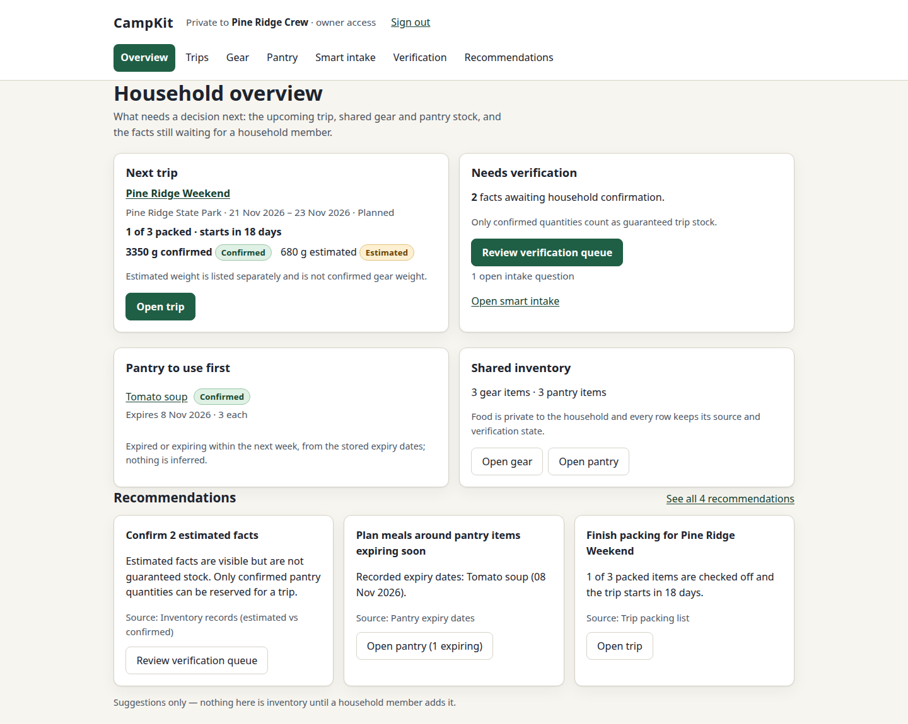

*The overview brings trip readiness, verification work, pantry dates, shared inventory, and recent changes together.*

## Contents

- [What you can do](#what-you-can-do)
- [Feature guides](#feature-guides)
  - [Accounts and private spaces](#accounts-private-spaces-and-invitations)
  - [Trips and packing](#plan-and-pack-trips)
  - [Shared gear and verification](#shared-gear-and-verification)
  - [Pantry, provenance, nutrition, and prices](#pantry-provenance-nutrition-and-prices)
  - [Meals and leftovers](#meal-planning-and-leftovers)
  - [Reusable gear kits](#reusable-gear-kits)
  - [Smart intake](#smart-intake-and-manual-review)
  - [Recommendations and recent changes](#recommendations-and-recent-changes)
  - [REST API and MCP](#rest-api-and-hermes-mcp)
- [Architecture](#architecture)
- [Local development](#local-development)
- [Privacy and security](#privacy-and-security-boundaries)
- [Status and limitations](#status-and-limitations)

## What you can do

- **Plan trips:** record dates, destination, party size, and conditions; add shared gear and track packed items and readiness.
- **Reuse packing lists:** save a trip’s current gear associations as a household kit, manage its name and item quantities, and seed a planned or confirmed trip from a kit or completed trip. Existing target rows stay unchanged; completed and cancelled packing history is read-only.
- **Track gear and pantry items:** search and edit records, retain source/provenance, and see estimates separately from confirmed facts. Only confirmed pantry quantities are treated as guaranteed stock.
- **Review intake:** submit a photo or barcode for optional provider-backed recognition. Candidates below confidence thresholds are held for member review; manual entry remains available when providers are not configured.
- **Plan meals and stock reservations:** associate meals and ingredients with a trip, then confirm a meal plan to reserve available confirmed pantry stock.
- **See sourced suggestions:** recommendations are explanatory suggestions, not inventory until a member adds them.
- **Keep an audit trail:** changes record the actor and action.

## Feature guides

### Accounts, private spaces, and invitations

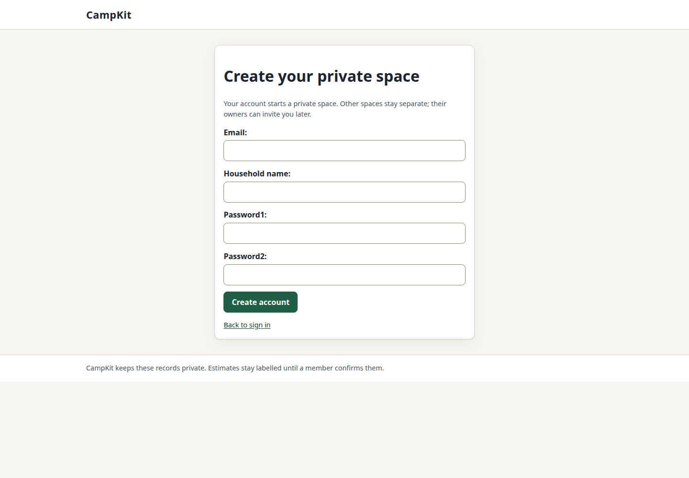

1. On a new instance, open `/accounts/signup/`, enter an email address, choose a household name and password, then sign in. Self-signup creates one private space and makes the registering account its owner.
2. Open `/accounts/login/` to sign in. An account with access to multiple spaces is prompted to choose which one to open. The header switcher only lists that account's memberships; each space's records remain separately scoped.
3. To invite someone, an owner must first be signed in to the intended space. There is no invitation-management form or automatic email sender yet: create an invitation with an authenticated, CSRF-protected `POST /accounts/invitations/` containing an `email` field. For example, with `cookies.txt` containing the owner's authenticated session and CSRF cookies; `CSRF_TOKEN` must match that session's `csrftoken` cookie:

   ```bash
   BASE_URL="https://your-private-campkit-host"
   CSRF_TOKEN="<csrftoken cookie from that session>"
   curl --fail-with-body -i -b cookies.txt -c cookies.txt \
     -H "X-CSRFToken: $CSRF_TOKEN" \
     -H "Referer: $BASE_URL/" \
     --data-urlencode "email=member@example.invalid" \
     "$BASE_URL/accounts/invitations/"
   ```

   The owner-only endpoint returns an invitation token; deliver the link privately as `BASE_URL/accounts/signup/<token>/`. Invitations expire after seven days. CampKit does **not** email the link automatically, so treat the token like a credential.

4. The invitee must use the invited email address. A new user chooses a password on the invite page; an existing user signs in with the matching account email to accept. Acceptance grants member access to that space.

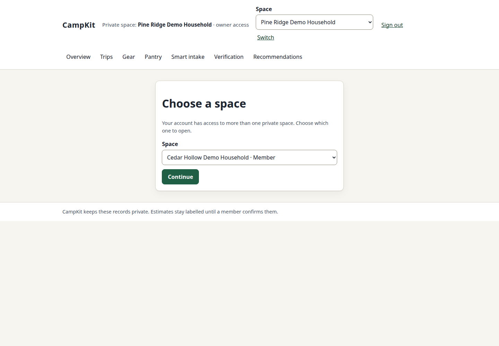

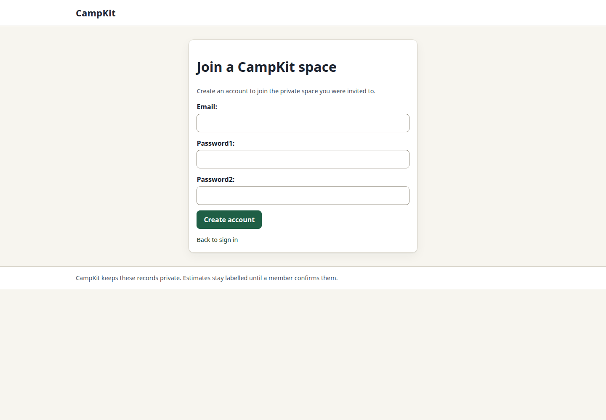

### Plan and pack trips

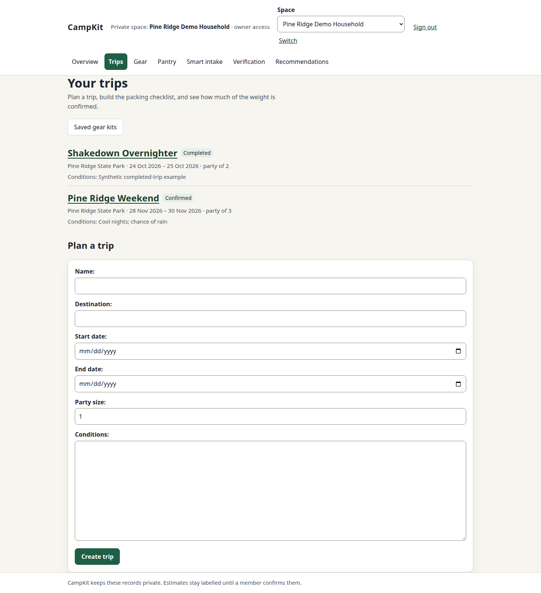

1. Open **Trips** and create a trip with its name, destination, dates, party size, and any conditions or notes.
2. Open the trip. Add existing shared gear directly, or start from a saved gear kit or completed trip. A packing list references the household gear record; it does not create a private copy of that gear.
3. Use **Mark packed** on each row as you pack. The trip summary shows the number packed and separates confirmed from estimated gear weight. Unknown or estimated weight is never represented as confirmed.
4. A planned trip can be confirmed. Completed and cancelled trips keep read-only packing history. Cancelling a trip also releases its reserved pantry food.


### Shared gear and verification

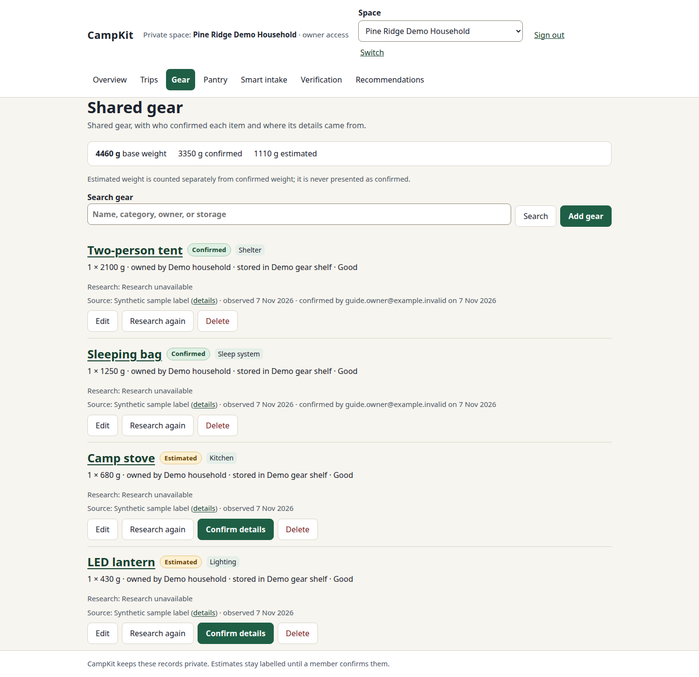

1. In **Gear**, choose **Add gear** and record known durable equipment, its quantity and any known per-item weight, owner, condition, storage location, and source details. Leave unknown facts blank; do not guess to make a record look complete.
2. Food and consumables belong in **Pantry**, not Gear. Gear uses a fixed category list: Backpack, Shelter, Sleep system, Cookware, Kitchen, Water, Lighting, Navigation, Tools & repair, Clothing, Climbing, Safety, Food storage, and Other.
3. New or materially edited facts remain **Estimated** until a member verifies them. Open **Verification** or the item record, compare the evidence/source with the real item, correct it if needed, then confirm. Confirmation records who did it and when; changing a confirmed fact can return it to estimated until verified again.
4. Trip lists and reusable kits refer to shared gear. Remove those references before deleting gear; a protected or referenced item is not silently removed from a household's lists.

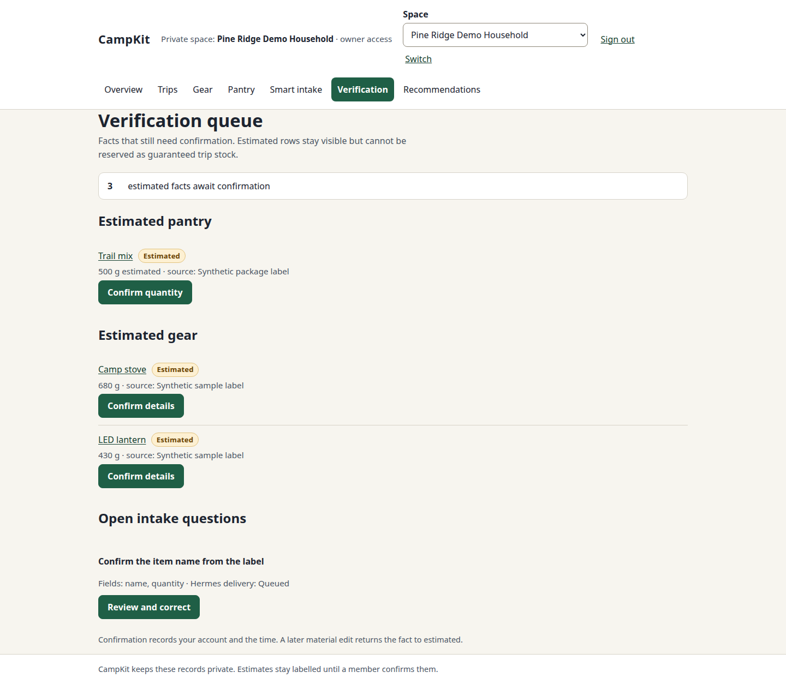

### Pantry, provenance, nutrition, and prices


1. Open **Pantry** and add a food item with its quantity and supported unit. Add an expiry date, storage location, source, and source link when known. A new quantity is estimated until a household member confirms it.
2. Use the detail page to inspect provenance and dated observations. Nutrition values and prices may be recorded from sources; they are evidence with an observation time, not a guarantee that a price or product is still available.
3. Confirm a quantity only after checking the actual stock. Confirmed quantities can be reserved for a meal plan; estimates stay visible but are not guaranteed stock.
4. Use the search box to find items by name, storage, or source. Update or correct a record rather than adding a duplicate when the existing item is the same stock.

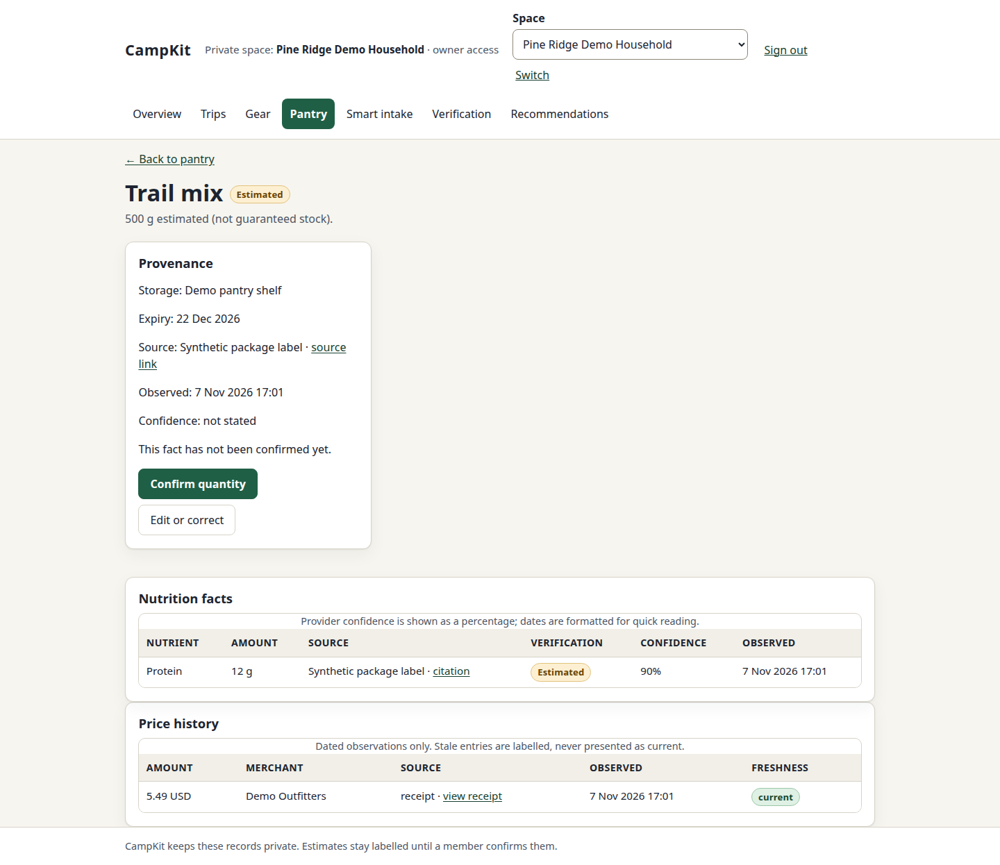

### Meal planning and leftovers

1. Create meals while a trip is **Planned**. Give each meal a name and servings, then optionally choose a pantry ingredient and quantity. Ingredient and pantry units must match.
2. **Confirm meal plan and reserve confirmed food** checks that every ingredient is confirmed and that enough stock exists. If a fact is estimated or the stock is insufficient, the plan is not reserved; verify or correct the pantry record first. Confirmation reduces available pantry stock and confirms the trip.
3. After the trip, enter the amount consumed for each reservation. CampKit records consumption and returns the unused remainder to confirmed pantry stock. Cancelling a trip releases outstanding reserved food instead.

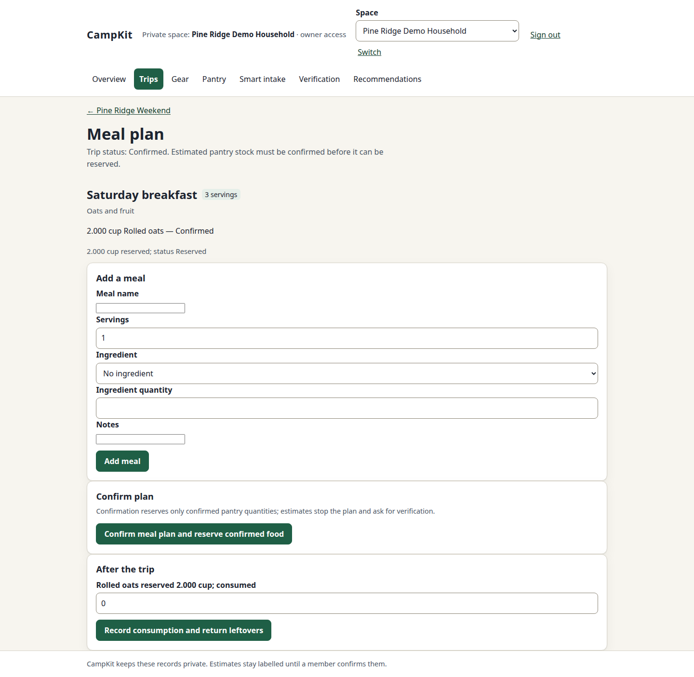

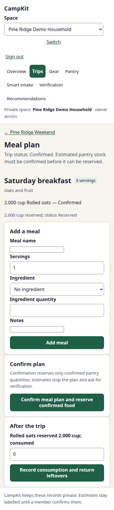

### Reusable gear kits

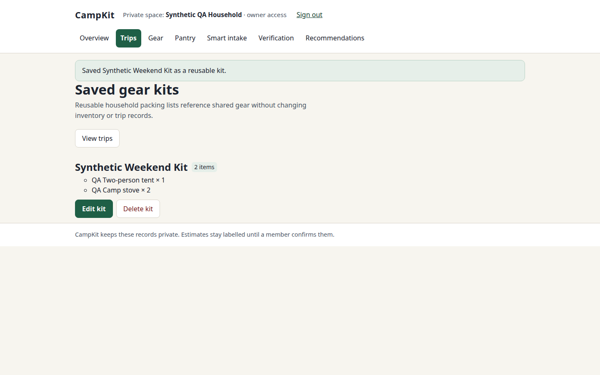

1. On a planned or confirmed trip with a packing list, choose **Save packing list as kit**, name the kit, and save it. The kit stores references to shared gear and quantities, not a second gear inventory.
2. Open **Saved gear kits** from Trips to edit the kit name or selected items and quantities, or delete the kit. Deleting a kit does not delete or modify shared gear, trips, or their packing lists.
3. To reuse it, open a planned or confirmed target trip and choose **Start from a kit or past trip**. Select a saved kit or completed trip, choose items and quantities, then use **Add selected gear**.
4. New target rows start **unpacked**. If an item is already on the target trip, CampKit skips it and leaves its existing quantity and packed state unchanged. The source kit or completed trip is not modified. Completed and cancelled target trips remain read-only.
5. If a source changes between display and submission, refresh and select it again; CampKit rejects a stale source snapshot rather than silently copying an outdated list.

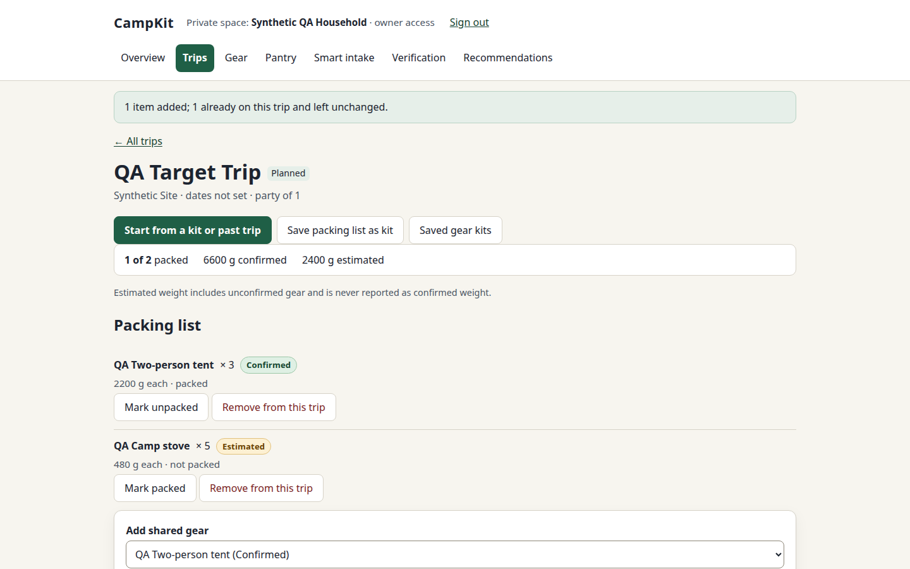


### Smart intake and manual review


1. Open **Smart intake** → **Add a photo or barcode**. Choose whether the item is gear or pantry, select the source, and submit a supported JPEG, PNG, or WebP photo and/or a barcode.
2. The private submission appears in intake review. If an optional recognition provider is configured, inspect its candidate fields, confidence, and source evidence; CampKit keeps uncertain candidates estimated and creates review work rather than silently trusting them. If no provider is configured, manual entry is still available.
3. Compare the candidate with the actual item and label. Correct fields and confirm, approve as shown, or reject it. A confirmed result is attributed to the reviewing account. Use the **Verification** queue to find open questions and estimates needing attention.
4. Intake images are space-scoped and served only to authenticated members of that space. Configuring a provider is optional; read the privacy section below before enabling an external service.

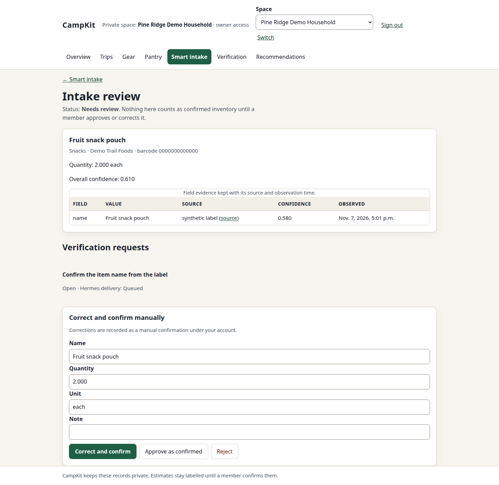

### Recommendations and recent changes

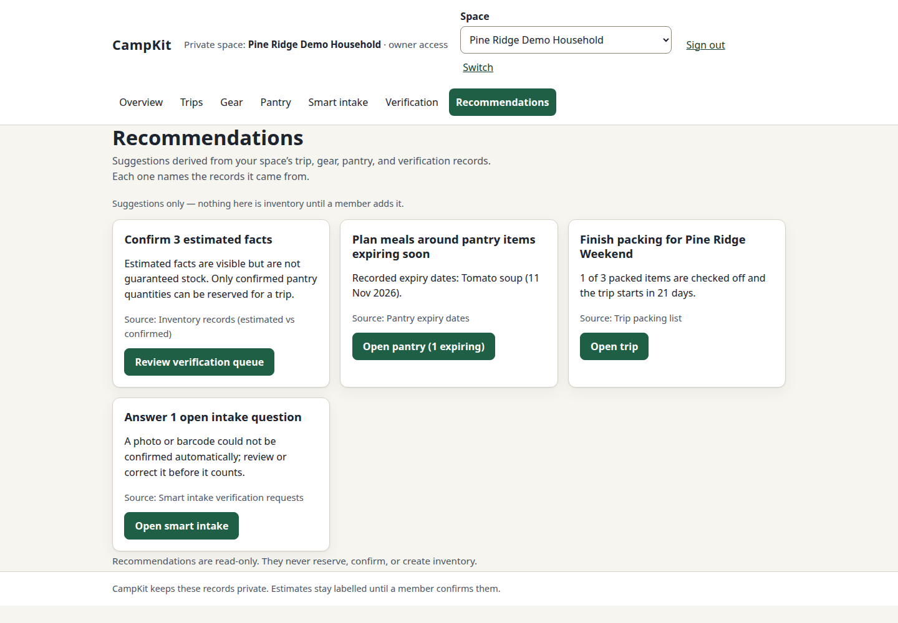

Recommendations summarize actionable follow-ups such as unconfirmed facts, expiring pantry stock, packing progress, or open intake questions. Each suggestion shows its source and links to the relevant workflow. Recommendations are **read-only**: opening or viewing one never confirms, reserves, creates, or deletes inventory. The dashboard also summarizes recent audited changes; it is an overview, not a separate audit-management screen.

### REST API and Hermes MCP

The optional integration surface is separate from the web guides above. Both adapters are household-scoped and call the same domain services as the UI; a valid token does not grant access to other spaces.

1. In a trusted Django shell, issue a household-scoped token with `apps.api.auth.issue_token(household=..., label=...)`. The raw token is returned once; only its digest is stored. Put it in the intended private secret store, never in source control, screenshots, or public logs. Revoke it with `apps.api.auth.revoke_token(...)` when no longer needed.
2. REST callers send `Authorization: Bearer <token>` and a JSON object to `/api/v1/`. Current routes are:

   - Trips: `GET`/`POST /trips/`, `GET /trips/{trip_id}/`, `POST /trips/{trip_id}/meals/`, and `POST /trips/{trip_id}/meals/confirm/`.
   - Gear: `GET`/`POST /gear/`, `GET`/`PATCH /gear/{item_id}/`, and `POST /gear/{item_id}/confirm/`.
   - Pantry: `GET`/`POST /pantry/`, `GET`/`PATCH /pantry/{item_id}/`, `POST /pantry/{item_id}/confirm/`, `GET`/`POST /pantry/{item_id}/prices/`, and `GET /pantry/{item_id}/nutrition/`.
   - Intake and verification: `GET /intake/`, `GET /intake/{submission_id}/`, `POST /intake/{submission_id}/review/`, and `GET /verification-requests/`.

   For example, after setting `BASE_URL` to the private host and `CAMPKIT_API_TOKEN` in a private environment, list the token's trips with `curl --fail-with-body -H "Authorization: Bearer $CAMPKIT_API_TOKEN" -H "Accept: application/json" "$BASE_URL/api/v1/trips/"`. Unsupported methods return 405. Gear-kit operations are **not** currently exposed through REST or MCP.
3. To run the MCP stdio server as a local process, set the private `CAMPKIT_MCP_TOKEN` in that process environment and run `python -m apps.mcp.server` from the configured CampKit environment. The available tools include listing/creating trips, listing/adding/updating gear and pantry, listing verification requests, confirming a fact, planning/confirming meals, reviewing intake, and recording a dated price. See `apps/mcp/tools.py` for schemas and `apps/mcp/server.py` for transport details. This repository does not modify or register Hermes configuration.
4. Sensitive MCP writes first return a `confirmation_required` result. Review the described mutation with the household member; only then repeat the call with `confirm=true`. The API/MCP allowlist has no delete, bulk-edit, or purchase tools.

The REST gear/pantry write allowlists omit `source` and `source_url`; those values can be silently ignored by API create/update calls. Use the web UI or the domain services for writes that must retain provenance. The `tests/api/` and `tests/mcp/` suites are the behavioral reference for request validation and confirmations.

## Architecture

CampKit is a server-rendered **Django 5.2** application (Python **3.12+**) organized into domain apps for accounts, inventory, trips, meals, intake, enrichment, audit, and integrations. PostgreSQL is the configured application database; the test settings use disposable SQLite. The web UI uses Django templates and static CSS/JavaScript. `compose.yaml` runs the web app with Gunicorn and PostgreSQL 16; see [deployment](deploy/README.md) for the full topology and operator steps.

The repository also includes a versioned REST API (`/api/v1/`) and a JSON-RPC stdio MCP server for Hermes. These adapters delegate to shared domain services, so they apply the same account access boundaries and business rules as the UI. MCP exposes an allowlist of tools; sensitive mutations require explicit confirmation, and destructive bulk/delete/purchase actions are not exposed. See `apps/api/`, `apps/mcp/`, and their tests. The MCP server is started as a local subprocess by an operator; this repository does not register it with Hermes automatically.

## Local development

Requirements: Python 3.12 or later and Git. The following commands install the app and test extras, then run the complete suite using the repository's test configuration (SQLite; no production database or deployed service is contacted):

```bash
python -m venv .venv
. .venv/bin/activate
python -m pip install -e '.[test]'
pytest -q
```

For a disposable local web session, use the test settings and a local SQLite file so the database persists between commands:

```bash
export DJANGO_SETTINGS_MODULE=config.settings_test
export CAMPKIT_TEST_DB="$PWD/.campkit-dev.sqlite3"
python manage.py migrate
python manage.py createsuperuser
python manage.py runserver 127.0.0.1:8000
```

The test settings use a test-only secret and disable secure-cookie/HTTPS redirects for local use. The test database contains only data you create locally; do not point `CAMPKIT_TEST_DB` at real user data. App pages require access to a private space, so a superuser alone is not a substitute for setting one up. Self-registration at `/accounts/signup/` creates a private space owned by the registrant. To join another space, follow its owner's invitation; existing account holders sign in to accept it and can switch spaces from the app header.

Useful checks:

```bash
pytest -q
python manage.py check --settings=config.settings_test
```

The suite includes server-rendered UI/accessibility smoke tests, private-space isolation, intake, API/MCP behavior, and end-to-end flows. It uses SQLite test settings by default; some deployment checks require a real container stack and are intentionally separate.

## Privacy and security boundaries

- **New accounts get a private space; owners invite people to join existing spaces.** Signed-in users can switch only between their memberships, and pages and records stay scoped to the selected space. Do not expose the service publicly without reviewing the [deployment security model](deploy/README.md#security-notes).
- Intake images are kept in a private data directory and served only through authenticated, space-scoped views. If an optional recognition provider is configured, submitted item photos may be sent to that provider for analysis; review that provider's privacy and retention terms before enabling it. With no provider configured, the null provider does not invent data and manual entry remains available.
- The REST API and MCP integration authenticate through a dedicated service identity; mutations are attributed to that identity in the audit trail. Review confirmation prompts before allowing sensitive actions.
- The included Compose deployment binds its web and database ports to host loopback and expects a TLS-terminating trusted-network/VPN reverse proxy. Operators must manage secrets, proxy/static-file configuration, backups, and access to that host. See [`deploy/README.md`](deploy/README.md).

## Integrations

- **REST API:** versioned private-space endpoints are mounted under `/api/v1/` for trips, gear, pantry, intake, and verification. Authentication and permission checks are enforced in the API layer. The repository's `tests/api/` suite is the best current reference for request behavior.
- **Hermes MCP:** the stdio JSON-RPC server exposes tools for trips, gear, pantry, verification, meal planning, intake review, and sourced price observations. Sensitive writes are confirmation-gated. The service identity and optional integration settings are described in `.env.example` and `apps/mcp/`.
- **Optional enrichment:** nutrition and product research providers can be configured. The shipped providers may require external credentials/services; absent optional credentials do not make manual records unavailable. Treat sourced or cached enrichment as dated evidence, not a guarantee of current price or availability.

## Status and limitations

CampKit is an early, self-hosted tool, not a managed or public cloud product. You operate the application, database, secrets, reverse proxy, and backups. The internal deployment's earlier live checks covered synthetic signup/login, invitations, space switching, and trip/gear/pantry/meal flows. Reusable gear kits were privately deployed on 2026-11-07 after passing 369 automated tests, independent review, and synthetic browser QA at desktop and mobile sizes. Post-deploy checks confirmed the app and database are healthy, migrations are applied, and the kits route redirects unauthenticated users to login; no authenticated kit flow was run against real household data. The screenshots above are synthetic local UI captures, not production data. The earlier isolated backup rehearsal contained no media files, so it did not prove recovery of non-empty intake-photo storage. Optional provider-backed integrations and other untested workflows still need separate validation. Provider-backed photo recognition, nutrition, and research depend on optional integrations and confidence thresholds; suggestions and unconfirmed records are not authoritative facts. Self-registration creates a private space owned by the registering account. Users join an existing space by accepting its owner's invitation and can switch among their memberships from the app header. There is no automatic purchasing, and the Hermes tool allowlist exposes no destructive bulk mutation.

Before using real user data, read the [deployment guide](deploy/README.md), configure a trusted private ingress and durable backups, and independently verify the deployment on your own host.

## Project references

- [Deployment, bootstrap, backups, restore, and security](deploy/README.md)
- [Django project settings](config/settings.py)
- [Tests](tests/)
- [REST API](apps/api/)
- [Hermes MCP integration](apps/mcp/)
