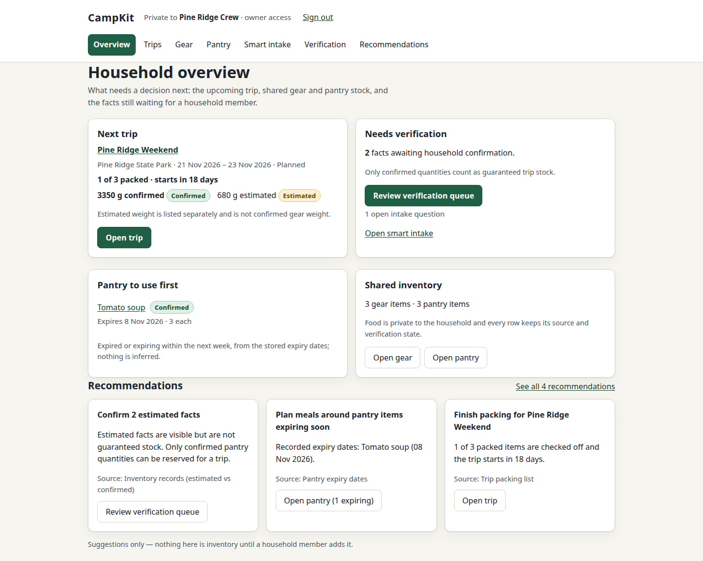
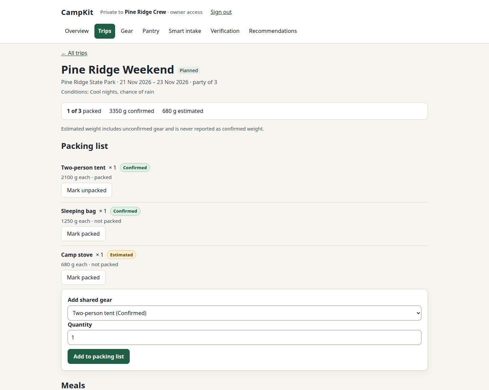
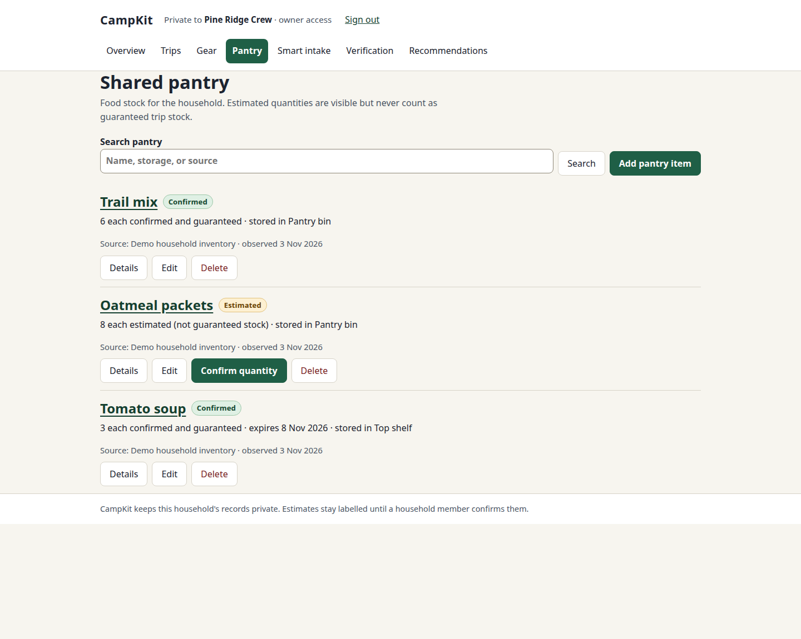
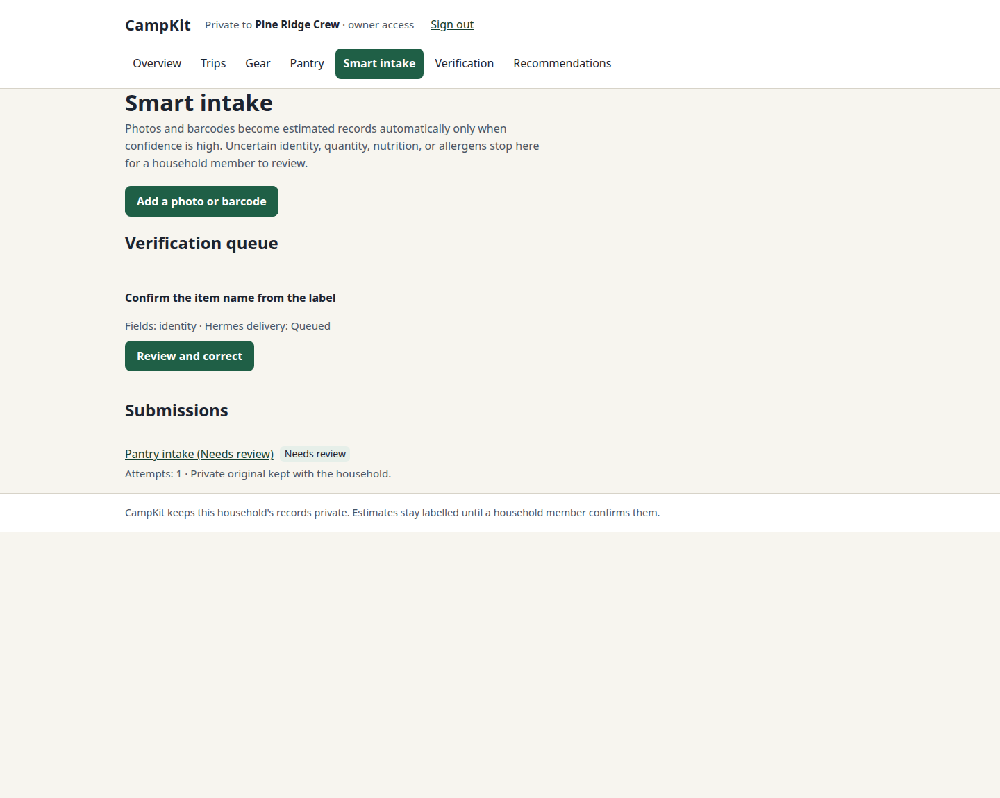

# CampKit

**A private, household-scoped planner for camping trips, shared gear, and pantry stock.** CampKit brings trip readiness and inventory together while keeping estimates visibly separate from facts a household member has confirmed.

> CampKit is an early, self-hosted project. It is not a public service, and deployment-backed checks are not claimed; see [project status and limitations](#status-and-limitations) and the [deployment guide](deploy/README.md).

## See CampKit

These are real browser captures of CampKit running locally against an isolated SQLite database seeded only with fictional household, trip, gear, pantry, and intake records. No production service, credentials, or household data was used.



*The overview brings trip readiness, pending verification, pantry dates, and shared inventory together.*



*Track packing progress without treating estimated gear weight as confirmed.*



*The pantry keeps source details visible and clearly labels unconfirmed quantities.*



*Uncertain intake stays in the household review queue instead of silently becoming trusted stock.*

## What you can do

- **Plan trips:** record dates, destination, party size, and conditions; add shared gear and track packed items and readiness.
- **Track household gear and pantry items:** search and edit records, retain source/provenance, and see estimates separately from confirmed facts. Only confirmed pantry quantities are treated as guaranteed stock.
- **Review intake:** submit a photo or barcode for optional provider-backed recognition. Candidates below confidence thresholds are held for household review; manual entry remains available when providers are not configured.
- **Plan meals and stock reservations:** associate meals and ingredients with a trip, then confirm a meal plan to reserve available confirmed pantry stock.
- **See sourced suggestions:** recommendations are explanatory suggestions, not inventory until a household member adds them.
- **Keep an audit trail:** household changes record the actor and action.

## Architecture

CampKit is a server-rendered **Django 5.2** application (Python **3.12+**) organized into domain apps for households, inventory, trips, meals, intake, enrichment, audit, and integrations. PostgreSQL is the configured application database; the test settings use disposable SQLite. The web UI uses Django templates and static CSS/JavaScript. `compose.yaml` runs the web app with Gunicorn and PostgreSQL 16; see [deployment](deploy/README.md) for the full topology and operator steps.

The repository also includes a versioned REST API (`/api/v1/`) and a JSON-RPC stdio MCP server for Hermes. These adapters delegate to shared domain services, so they apply the same household boundaries and business rules as the UI. MCP exposes an allowlist of tools; sensitive mutations require explicit confirmation, and destructive bulk/delete/purchase actions are not exposed. See `apps/api/`, `apps/mcp/`, and their tests. The MCP server is started as a local subprocess by an operator; this repository does not register it with Hermes automatically.

## Local development

Requirements: Python 3.12 or later and Git. The following commands install the app and test extras, then run the complete suite using the repository's test configuration (SQLite; no production database or deployed service is contacted):

```bash
python -m venv .venv
. .venv/bin/activate
python -m pip install -e '.[test]'
pytest -q
```

For a disposable local web session, use the test settings and a local SQLite file so the database persists between commands:

```bash
export DJANGO_SETTINGS_MODULE=config.settings_test
export CAMPKIT_TEST_DB="$PWD/.campkit-dev.sqlite3"
python manage.py migrate
python manage.py createsuperuser
python manage.py runserver 127.0.0.1:8000
```

The test settings use a test-only secret and disable secure-cookie/HTTPS redirects for local use. The test database contains only data you create locally; do not point `CAMPKIT_TEST_DB` at household data. Household pages require a household membership, so a superuser alone is not a substitute for household bootstrap. CampKit sign-up is invitation-only; use the [deployment guide's first-run instructions](deploy/README.md#first-run) to bootstrap an owner and initial invitation, with local-only credentials for development.

Useful checks:

```bash
pytest -q
python manage.py check --settings=config.settings_test
```

The suite includes server-rendered UI/accessibility smoke tests, household isolation, intake, API/MCP behavior, and end-to-end flows. It uses SQLite test settings by default; some deployment checks require a real container stack and are intentionally separate.

## Privacy and security boundaries

- CampKit accounts are invitation-only, and application pages and records are scoped to a household. Do not expose the service publicly without reviewing the [deployment security model](deploy/README.md#security-notes).
- Intake images are kept in a private data directory and served only through authenticated household-scoped views. A configured vision provider receives item photos only when the household authorizes that processing; provider credentials are optional. With no provider configured, the null provider does not invent data and manual entry remains available.
- The REST API and MCP integration authenticate through a dedicated service identity; mutations are attributed to that identity in the audit trail. Review confirmation prompts before allowing sensitive actions.
- The included Compose deployment binds its web and database ports to host loopback and expects a TLS-terminating trusted-network/VPN reverse proxy. Operators must manage secrets, proxy/static-file configuration, backups, and access to that host. See [`deploy/README.md`](deploy/README.md).

## Integrations

- **REST API:** versioned household endpoints are mounted under `/api/v1/` for trips, gear, pantry, intake, and verification. Authentication and permission checks are enforced in the API layer. The repository's `tests/api/` suite is the best current reference for request behavior.
- **Hermes MCP:** the stdio JSON-RPC server exposes household tools for trips, gear, pantry, verification, meal planning, intake review, and sourced price observations. Sensitive writes are confirmation-gated. The service identity and optional integration settings are described in `.env.example` and `apps/mcp/`.
- **Optional enrichment:** nutrition and product research providers can be configured. The shipped providers may require external credentials/services; absent optional credentials do not make manual records unavailable. Treat sourced or cached enrichment as dated evidence, not a guarantee of current price or availability.

## Status and limitations

CampKit is an early, self-hosted household tool, not a managed or public cloud product. You operate the application, database, secrets, reverse proxy, and backups. The deployment guide explicitly notes checks that require Docker/PostgreSQL or a live deployment and were not run in its authoring environment; do not interpret this README as a claim that a production deployment has been exercised. Provider-backed photo recognition, nutrition, and research depend on optional integrations and confidence thresholds; suggestions and unconfirmed records are not authoritative facts. Accounts are invitation-only; owners can invite members. There is no automatic purchasing, and the Hermes tool allowlist exposes no destructive bulk mutation.

Before using real household data, read the [deployment guide](deploy/README.md), configure a trusted private ingress and durable backups, and independently verify the deployment on your own host.

## Project references

- [Deployment, bootstrap, backups, restore, and security](deploy/README.md)
- [Django project settings](config/settings.py)
- [Tests](tests/)
- [REST API](apps/api/)
- [Hermes MCP integration](apps/mcp/)
