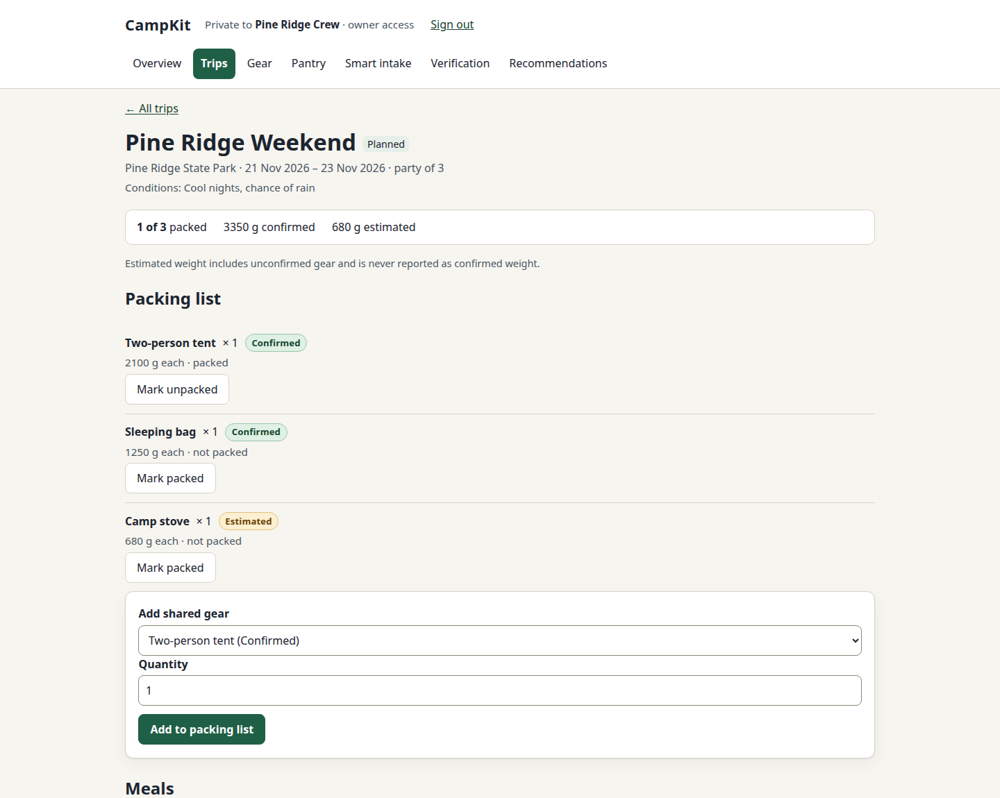
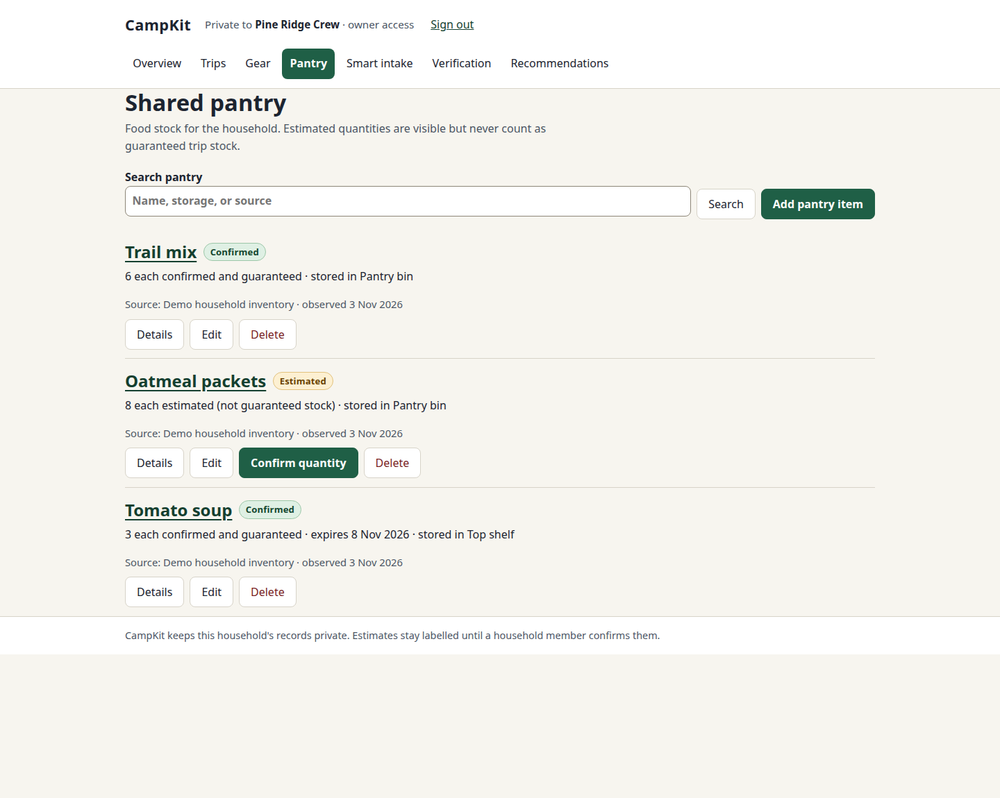
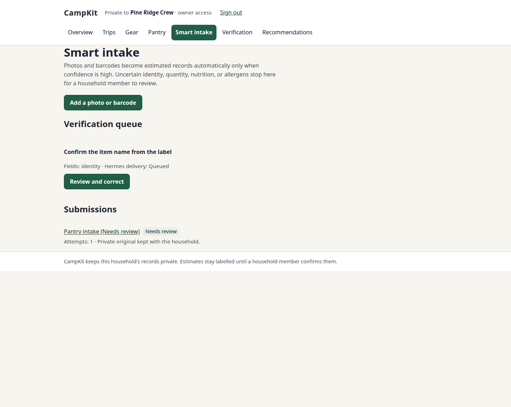
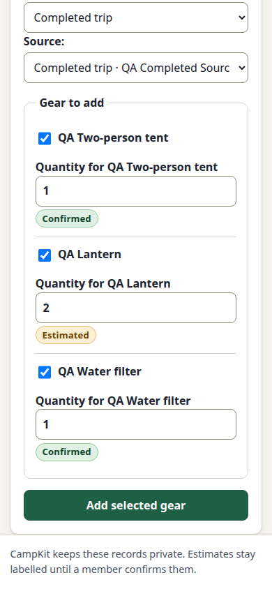

# CampKit

**A private planner for camping trips, shared gear, and pantry stock.** CampKit brings trip readiness and inventory together while keeping estimates visibly separate from facts a member has confirmed.

> CampKit is an early, self-hosted project, not a public service. Reusable gear kits are now included in the private deployment (2026-11-07). They passed 369 automated tests, independent code review, and synthetic desktop/mobile browser QA. The screenshots below use synthetic local data and are not captures of the private deployment. Authenticated gear-kit behavior has not been exercised against real household data. See [project status and limitations](#status-and-limitations) and the [deployment guide](deploy/README.md).

## See CampKit

These are real browser captures of CampKit running locally against an isolated SQLite database seeded only with fictional account-space, trip, gear, pantry, and intake records. No production service, credentials, or real user data was used.


*The overview brings trip readiness, pending verification, pantry dates, and shared inventory together.*



*Track packing progress without treating estimated gear weight as confirmed.*



*The pantry keeps source details visible and clearly labels unconfirmed quantities.*



*Uncertain intake stays in the review queue instead of silently becoming trusted stock.*

### Reusable packing kits

These current-branch screenshots use synthetic-only household, trip, and gear records; they were captured from the actual app at desktop and mobile sizes during the isolated browser QA. They are not screenshots of the private deployment.


*Save a trip packing list as a reusable household kit, then edit or remove the kit without changing shared gear.*


*Copy selected gear to a planned trip; an existing trip row keeps its quantity and packed state.*



*The seed form adapts to a narrow viewport and remains usable with ordinary vertical scrolling.*

## What you can do

- **Plan trips:** record dates, destination, party size, and conditions; add shared gear and track packed items and readiness.
- **Reuse packing lists:** save a trip’s current gear associations as a household kit, manage its name and item quantities, and seed a planned or confirmed trip from a kit or completed trip. Existing target rows stay unchanged; completed and cancelled packing history is read-only.
- **Track gear and pantry items:** search and edit records, retain source/provenance, and see estimates separately from confirmed facts. Only confirmed pantry quantities are treated as guaranteed stock.
- **Review intake:** submit a photo or barcode for optional provider-backed recognition. Candidates below confidence thresholds are held for member review; manual entry remains available when providers are not configured.
- **Plan meals and stock reservations:** associate meals and ingredients with a trip, then confirm a meal plan to reserve available confirmed pantry stock.
- **See sourced suggestions:** recommendations are explanatory suggestions, not inventory until a member adds them.
- **Keep an audit trail:** changes record the actor and action.

## Architecture

CampKit is a server-rendered **Django 5.2** application (Python **3.12+**) organized into domain apps for accounts, inventory, trips, meals, intake, enrichment, audit, and integrations. PostgreSQL is the configured application database; the test settings use disposable SQLite. The web UI uses Django templates and static CSS/JavaScript. `compose.yaml` runs the web app with Gunicorn and PostgreSQL 16; see [deployment](deploy/README.md) for the full topology and operator steps.

The repository also includes a versioned REST API (`/api/v1/`) and a JSON-RPC stdio MCP server for Hermes. These adapters delegate to shared domain services, so they apply the same account access boundaries and business rules as the UI. MCP exposes an allowlist of tools; sensitive mutations require explicit confirmation, and destructive bulk/delete/purchase actions are not exposed. See `apps/api/`, `apps/mcp/`, and their tests. The MCP server is started as a local subprocess by an operator; this repository does not register it with Hermes automatically.

## Local development

Requirements: Python 3.12 or later and Git. The following commands install the app and test extras, then run the complete suite using the repository's test configuration (SQLite; no production database or deployed service is contacted):

```bash
python -m venv .venv
. .venv/bin/activate
python -m pip install -e '.[test]'
pytest -q
```

For a disposable local web session, use the test settings and a local SQLite file so the database persists between commands:

```bash
export DJANGO_SETTINGS_MODULE=config.settings_test
export CAMPKIT_TEST_DB="$PWD/.campkit-dev.sqlite3"
python manage.py migrate
python manage.py createsuperuser
python manage.py runserver 127.0.0.1:8000
```

The test settings use a test-only secret and disable secure-cookie/HTTPS redirects for local use. The test database contains only data you create locally; do not point `CAMPKIT_TEST_DB` at real user data. App pages require access to a private space, so a superuser alone is not a substitute for setting one up. Self-registration at `/accounts/signup/` creates a private space owned by the registrant. To join another space, follow its owner's invitation; existing account holders sign in to accept it and can switch spaces from the app header.

Useful checks:

```bash
pytest -q
python manage.py check --settings=config.settings_test
```

The suite includes server-rendered UI/accessibility smoke tests, private-space isolation, intake, API/MCP behavior, and end-to-end flows. It uses SQLite test settings by default; some deployment checks require a real container stack and are intentionally separate.

## Privacy and security boundaries

- **New accounts get a private space; owners invite people to join existing spaces.** Signed-in users can switch only between their memberships, and pages and records stay scoped to the selected space. Do not expose the service publicly without reviewing the [deployment security model](deploy/README.md#security-notes).
- Intake images are kept in a private data directory and served only through authenticated, space-scoped views. A configured vision provider receives item photos only when an authorized member allows that processing; provider credentials are optional. With no provider configured, the null provider does not invent data and manual entry remains available.
- The REST API and MCP integration authenticate through a dedicated service identity; mutations are attributed to that identity in the audit trail. Review confirmation prompts before allowing sensitive actions.
- The included Compose deployment binds its web and database ports to host loopback and expects a TLS-terminating trusted-network/VPN reverse proxy. Operators must manage secrets, proxy/static-file configuration, backups, and access to that host. See [`deploy/README.md`](deploy/README.md).

## Integrations

- **REST API:** versioned private-space endpoints are mounted under `/api/v1/` for trips, gear, pantry, intake, and verification. Authentication and permission checks are enforced in the API layer. The repository's `tests/api/` suite is the best current reference for request behavior.
- **Hermes MCP:** the stdio JSON-RPC server exposes tools for trips, gear, pantry, verification, meal planning, intake review, and sourced price observations. Sensitive writes are confirmation-gated. The service identity and optional integration settings are described in `.env.example` and `apps/mcp/`.
- **Optional enrichment:** nutrition and product research providers can be configured. The shipped providers may require external credentials/services; absent optional credentials do not make manual records unavailable. Treat sourced or cached enrichment as dated evidence, not a guarantee of current price or availability.

## Status and limitations

CampKit is an early, self-hosted tool, not a managed or public cloud product. You operate the application, database, secrets, reverse proxy, and backups. The internal deployment's earlier live checks covered synthetic signup/login, invitations, space switching, and trip/gear/pantry/meal flows. Reusable gear kits were privately deployed on 2026-11-07 after passing 369 automated tests, independent review, and synthetic browser QA at desktop and mobile sizes. Post-deploy checks confirmed the app and database are healthy, migrations are applied, and the kits route redirects unauthenticated users to login; no authenticated kit flow was run against real household data. The screenshots above are synthetic local UI captures, not production data. The earlier isolated backup rehearsal contained no media files, so it did not prove recovery of non-empty intake-photo storage. Optional provider-backed integrations and other untested workflows still need separate validation. Provider-backed photo recognition, nutrition, and research depend on optional integrations and confidence thresholds; suggestions and unconfirmed records are not authoritative facts. Self-registration creates a private space owned by the registering account. Users join an existing space by accepting its owner's invitation and can switch among their memberships from the app header. There is no automatic purchasing, and the Hermes tool allowlist exposes no destructive bulk mutation.

Before using real user data, read the [deployment guide](deploy/README.md), configure a trusted private ingress and durable backups, and independently verify the deployment on your own host.

## Project references

- [Deployment, bootstrap, backups, restore, and security](deploy/README.md)
- [Django project settings](config/settings.py)
- [Tests](tests/)
- [REST API](apps/api/)
- [Hermes MCP integration](apps/mcp/)
